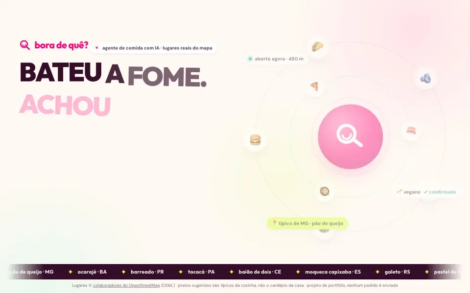
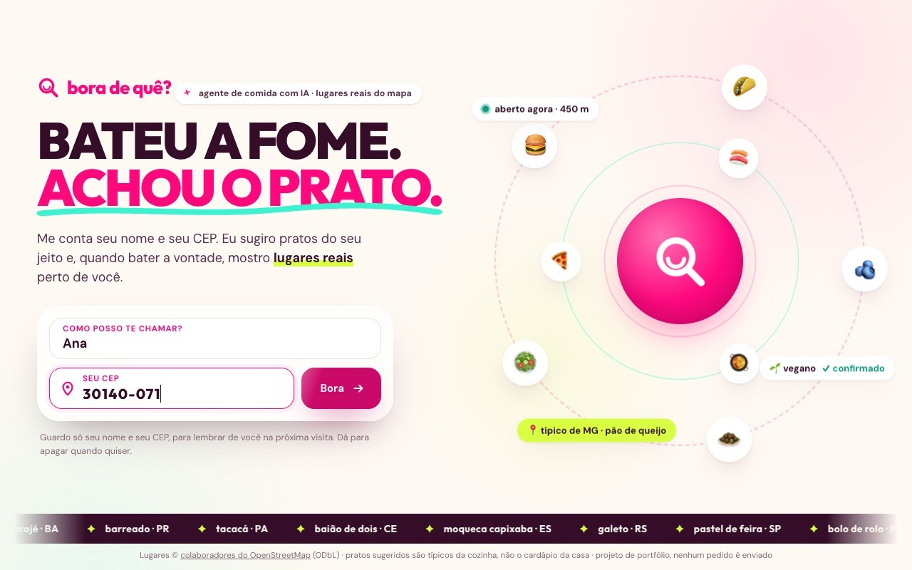
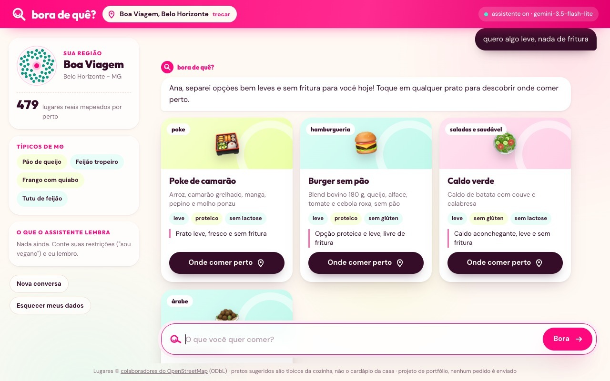
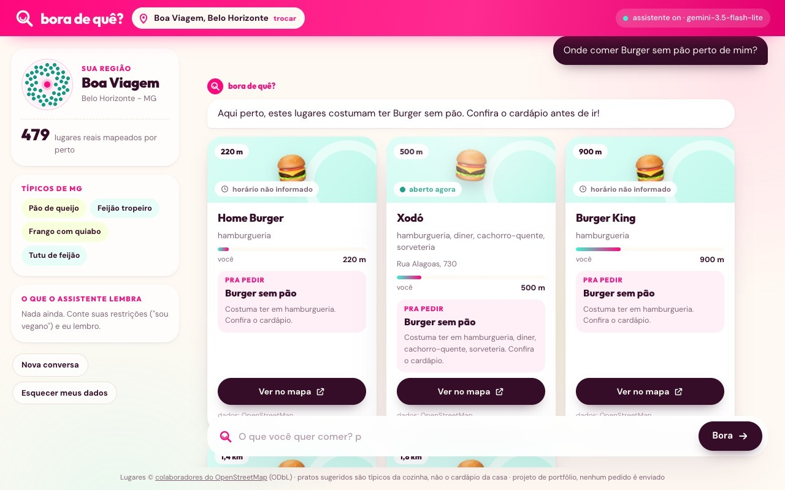
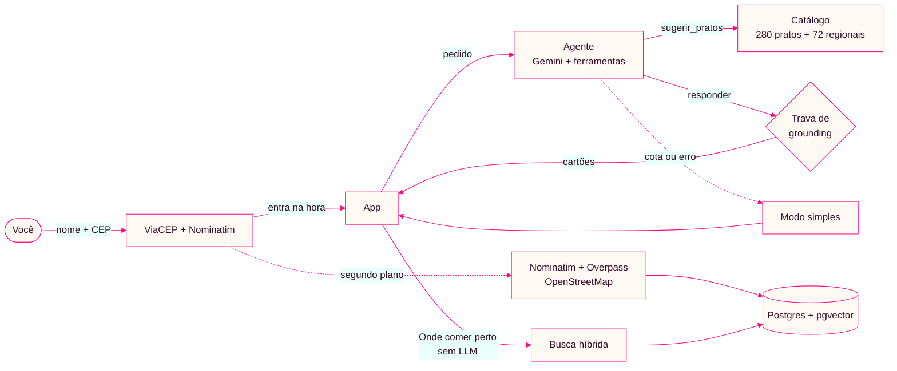

<p align="center">
  
</p>

<p align="center">
  
  
  
  
  
  
</p>

<h3 align="center">Você conta a vontade. O agente sugere o prato.<br>Você escolhe e vê onde comer perto do seu CEP, em lugares que existem.</h3>

<p align="center">
  <a href="https://bora-de-que.onrender.com"></a>
  <br>
  <sub>Versão enxuta num servidor gratuito. Se ela estiver dormindo, a primeira carga leva até 1 minuto.</sub>
</p>

<p align="center">
  <a href="https://bora-de-que.onrender.com"><b>Demo ao vivo</b></a> ·
  <a href="#-veja-funcionando"><b>Vídeo</b></a> ·
  <a href="#-do-cep-ao-prato"><b>Passo a passo</b></a> ·
  <a href="#-por-dentro"><b>Por dentro</b></a> ·
  <a href="#-números"><b>Números</b></a> ·
  <a href="#-rode-no-seu-computador"><b>Rodar local</b></a> ·
  <a href="docs/COMO-FUNCIONA.md"><b>Guia completo</b></a>
</p>

> [!NOTE]
> **Projeto de estudo.** Construí o bora de quê? para aplicar na prática o que estudei de LLMs: agente com ferramentas, busca híbrida, fine-tuning, avaliação e deploy, com dados reais no lugar de exemplos de brinquedo. Ele não foi feito para uso no dia a dia nem para ser replicado como serviço. Mais em [Sobre o projeto](#-sobre-o-projeto).

<br>

## 🎬 Veja funcionando

<p align="center">
  
</p>

<p align="center"><sub>Gravação real do app em Belo Horizonte (CEP 30140-071). Encurtei só a espera da resposta do Gemini, de 3,4 s para 2,6 s.</sub></p>

<p align="center">Quer testar com o seu CEP? <a href="https://bora-de-que.onrender.com"><b>Abra a demo ao vivo</b></a>.</p>

## 🧭 Do CEP ao prato

<p align="center">
  
</p>

<table>
<tr>
<td width="33%" valign="top">

<p><b>1. Nome e CEP</b></p>
<p>Você digita como quer ser chamado e o CEP. O app consulta o ViaCEP, pega as coordenadas no Nominatim e libera a entrada em 1 a 2 segundos. Na volta, ele lembra de você.</p>
</td>
<td width="33%" valign="top">

<p><b>2. O que comer</b></p>
<p>Você escreve do seu jeito: "algo leve", "pós-treino", "uma coisa típica daqui". O agente busca no catálogo de 280 pratos e 72 regionais e explica cada escolha. Restaurante ainda não aparece aqui.</p>
</td>
<td width="33%" valign="top">

<p><b>3. Onde comer</b></p>
<p>Escolheu o prato, toca em <b>Onde comer perto</b>. A busca roda direto no banco, sem LLM, e mostra lugares reais com distância, horário, endereço e site.</p>
</td>
</tr>
</table>

### O que acontece em cada passo

**1. Você informa o CEP.** O servidor responde na hora e começa a baixar os restaurantes da região em segundo plano, em duas levas. O Nominatim traz os primeiros lugares em cerca de 1 segundo por tipo (restaurante, lanchonete, padaria, café, sorveteria). O Overpass completa o raio de 2,5 km em até um minuto. O radar da barra lateral mostra esse progresso. A região fica salva por 30 dias.

**2. Você pede um prato.** O agente, um Gemini com chamada de ferramentas, chama `sugerir_pratos`. Um extrator transforma seu texto em filtros (categoria, restrições, o que evitar, vontades como "leve") e soma o que ele já sabe de você, como "sou vegano". O catálogo devolve opções variadas, com destaque para os pratos típicos do seu estado.

**3. O código confere a resposta.** Antes de chegar à tela, a trava de grounding checa se cada prato e cada lugar vieram de uma ferramenta. ID inventado volta para o modelo corrigir uma vez. Na segunda falha, o item sai. Nome, distância e links dos cartões vêm do banco, nunca do texto do modelo.

**4. Você escolhe onde comer.** O botão chama `/api/onde-comer`. A busca procura casas cujo nome indica o prato ("Tapiocaria" para tapioca), depois casas cuja cozinha costuma servi-lo, depois cozinhas parecidas (poke leva a japonesa), sempre marcando o nível de certeza. A ordem segue a força da evidência e, em seguida, a distância. O raio começa em 3 km e dobra até 8 km se faltar opção.

**5. O app lembra o que importa.** Se você diz "sou vegetariano", o agente salva. Se diz "hoje nada de fritura", não salva, porque isso vale só para hoje. O botão **Esquecer meus dados** apaga nome, CEP, memória e conversas.

## 🔎 O que é real e o que é palpite

Ninguém publica cardápio com preço de forma aberta. Os apps de delivery têm esse dado, mas os termos de uso proíbem raspar. Inventar cardápio para um restaurante que existe seria mentir sobre um negócio real. Então o app separa as duas coisas e mostra a diferença no cartão.

| Vem do OpenStreetMap (real) | O app deduz (e avisa) |
|---|---|
| Nome, endereço e distância | "Costuma ter em hamburgueria" |
| Horário e se está aberto agora | "Vegano: costuma ter", pela cozinha |
| Site e telefone | "Deduzido pelo nome" |
| "Vegano ✓ confirmado", quando a casa informa | "Pode ter", para cozinha parecida |

Três regras seguram os exageros:

- "Costuma ter opção vegana" exige pelo menos 2 pratos veganos típicos daquela cozinha.
- Casa vegetariana confirmada só recebe sugestão vegetariana.
- O app não filtra por preço, nota ou tempo de entrega. Se você pede "até 40 reais", ele diz que não tem esse dado.

## ⚙️ Por dentro



| Parte | Como funciona |
|---|---|
| **Agente** | Gemini 3.5 flash-lite com chamada de ferramentas no modo obrigatório. O turno termina na ferramenta `responder`, com no máximo 6 passos. As outras ferramentas são `sugerir_pratos`, `onde_comer`, `buscar_lugares` e `salvar_preferencia`. |
| **Trava de grounding** | Confere os IDs da resposta contra o que as ferramentas devolveram. Primeira falha: o modelo corrige. Segunda: o item sai. |
| **Restrições lidas duas vezes** | O modelo reescreve o pedido antes de buscar e já perdeu "nada apimentado" no caminho. As restrições da mensagem original passam também pelo extrator de regras e valem sempre. |
| **Modo simples** | Se o Gemini falha por cota, rede ou limite de passos, a resposta sai do extrator de regras com o catálogo. Você vê um aviso, nunca uma tela de erro. |
| **Busca híbrida** | Três rankings (distância, full-text do Postgres e similaridade de embeddings no pgvector) fundidos por RRF, com k = 60. O RRF junta posições, então dispensa calibrar escalas que não se comparam. |
| **Embeddings** | `paraphrase-multilingual-MiniLM-L12-v2` via fastembed, 384 dimensões, rodando em CPU. |
| **Trace** | Cada resposta tem um "Como cheguei aqui" com as chamadas ao LLM, as ferramentas, os argumentos, a latência, os tokens e o custo. |

<details>
<summary><b>Stack completa</b></summary>
<br>

| Camada | Tecnologia |
|---|---|
| API | Python 3.12, FastAPI, Uvicorn, Pydantic |
| Banco | PostgreSQL 16 no Neon, pgvector (HNSW), full-text em português, psycopg 3 com pool |
| IA | Gemini 3.5 flash-lite (`google-genai`), fastembed, Qwen2.5-0.5B + LoRA (mlx-lm) |
| Dados | ViaCEP, BrasilAPI, Nominatim, Overpass API (OpenStreetMap) |
| Interface | HTML, CSS e JavaScript sem framework e sem build, View Transitions, fontes Outfit e DM Sans |
| Qualidade | pytest com Postgres embutido (pgserver), ruff, GitHub Actions |
| Deploy | Docker, Hugging Face Spaces |

</details>

## 📊 Números

<p align="center">
  
</p>

O extrator transforma o texto em filtros. Medi quatro versões em dois conjuntos: 100 pedidos que escrevi e rotulei à mão, e 80 pedidos "desafio" em outros estilos (gíria, formal, ressaca, só "fome"). O Gemini escreveu os textos do desafio e eu rotulei pelo [guia de rotulagem](docs/guia-de-rotulagem.md).

A busca roda sobre recortes **congelados** do OpenStreetMap de quatro capitais (São Paulo, Belo Horizonte, Salvador e Recife). Assim a avaliação de hoje e a de daqui a um mês olham para os mesmos lugares.

<details>
<summary><b>Tabelas completas</b> (geradas por <code>evals/relatorio.py</code>, nada digitado à mão)</summary>
<br>

<!-- resultados:inicio -->
#### Extração de filtros (100 pedidos escritos à mão)

| Extrator | Acerto exato | Média por campo | JSON válido | Latência p50 | Latência p95 | Custo / 1.000 pedidos |
|---|---|---|---|---|---|---|
| Regras (baseline) | 90,0% | 98,8% | 100,0% | 0 ms | 1 ms | US$ 0 (CPU própria) |
| Qwen2.5-0.5B sem ajuste (prompt com o guia) | 10,0% | 80,9% | 1,0% | 2.941 ms | 3.778 ms | US$ 0 (CPU própria) |
| Qwen2.5-0.5B + LoRA (local) | 58,0% | 92,9% | 98,0% | 517 ms | 831 ms | US$ 0 (CPU própria) |
| gemini-3.5-flash-lite via API | 93,0% | 99,1% | 100,0% | 971 ms | 1.490 ms | US$ 0,37 |

#### Acerto por campo

| Campo | Regras (baseline) | Qwen2.5-0.5B sem ajuste (prompt com o guia) | Qwen2.5-0.5B + LoRA (local) | Gemini via API |
|---|---|---|---|---|
| `categorias` | 95,0% | 33,0% | 76,0% | 97,0% |
| `preco_max` | 100,0% | 89,0% | 99,0% | 100,0% |
| `restricoes` | 100,0% | 80,0% | 94,0% | 99,0% |
| `evitar` | 99,0% | 91,0% | 94,0% | 100,0% |
| `atributos` | 98,0% | 79,0% | 91,0% | 98,0% |
| `distancia_max_km` | 98,0% | 95,0% | 99,0% | 100,0% |
| `tempo_max_min` | 100,0% | 93,0% | 99,0% | 100,0% |
| `ordenar_por` | 100,0% | 87,0% | 91,0% | 99,0% |

#### Extração no conjunto desafio

| Extrator | Acerto exato | Média por campo | JSON válido | Latência p50 | Latência p95 | Custo / 1.000 pedidos |
|---|---|---|---|---|---|---|
| Regras (baseline) | 66,2% | 95,2% | 100,0% | 1 ms | 2 ms | US$ 0 (CPU própria) |
| Qwen2.5-0.5B + LoRA (local) | 25,0% | 85,3% | 97,5% | 578 ms | 1.049 ms | US$ 0 (CPU própria) |
| gemini-3.5-flash-lite via API | 86,2% | 97,3% | 100,0% | 944 ms | 1.732 ms | US$ 0,36 |

#### Busca em lugares reais

| Filtros | Categoria certa | Restrições respeitadas | Item a evitar respeitado | Prato citado aparece | Sem resultado |
|---|---|---|---|---|---|
| gabarito | 100,0% | 100,0% | 100,0% | 89,6% | 4,5% |
| regras | 95,3% | 100,0% | 100,0% | 87,5% | 4,5% |
| modelo ajustado | 93,4% | 70,5% | 76,5% | 79,2% | 4,8% |
| Gemini | 98,5% | 100,0% | 100,0% | 92,7% | 4,5% |

Top-3 de 400 buscas (100 pedidos × 4 capitais), sobre recortes reais e congelados do OpenStreetMap.
<!-- resultados:fim -->

</details>

**Como ler.** As regras acertam 90% no conjunto principal porque escrevi o léxico e os casos. No desafio elas caem para 66%, e não mexi nas regras olhando esses erros. Com os filtros do gabarito, categoria e restrições dão 100% por construção, porque a busca filtra por eles. Essas linhas mostram que a busca respeita os filtros; a qualidade da extração aparece nas outras.

## 🧠 Decisões

**Pratos primeiro, lugares depois.** O catálogo resolve bem o que comer. O onde comer é a parte com dado real: distância, horário, dieta confirmada. Separar os dois deixa você entrar em 1 a 2 segundos enquanto o mapa baixa.

**"Onde comer perto" sem LLM.** Com o prato escolhido, achar lugares é uma busca determinística. Um LLM ali só traria latência e gasto de cota.

**Duas fontes para o mesmo mapa.** O Overpass leva de 35 a 60 segundos. O Nominatim devolve até 40 lugares por tipo em cerca de 1 segundo. As duas usam o mesmo ID do OSM, então a segunda leva só completa a primeira. Em Sorocaba, o primeiro "Onde comer perto" respondeu 3,6 segundos depois do CEP. Antes eram 60.

**Modelo escolhido pela cota.** No plano gratuito, o Gemini Flash dá 20 requisições por dia, umas 7 conversas. O flash-lite dá 15 por minuto. Ele segue instruções pior, e por isso existem a trava, a leitura dupla das restrições e o modo simples.

**Dedução pelo nome em três camadas.** O app olha primeiro o que a casa vende, depois a origem, depois palavras genéricas. "Pastel do Japonês" vira pastelaria; "Restaurante Japonês" vira japonês.

## 🩹 O que deu errado (e o que mudei)

- **Restaurante vegetariano com salmão.** O juiz da avaliação deu nota 1 para uma "Salada com salmão grelhado" num restaurante vegetariano. Hoje o app filtra os pratos das casas com dieta confirmada, em vez de só reordenar.
- **"Algo leve" trazia carne de onça.** O destaque dos regionais empurrou um prato sem tags para um pedido de leve. Regionais sem tag saem quando você pede uma vontade específica.
- **McDonald's com "burger vegano típico da casa".** O prato é típico de hamburgueria, não do cardápio daquela rede. O cartão passou a dizer de onde vem a sugestão.
- **O agente guardava vontades do momento.** "Hoje nada de fritura" virava "sem fritura" para sempre. O prompt agora só salva fato permanente.
- **A avaliação da busca oscilava entre 99,5% e 100%.** Lugares empatados (filiais com o mesmo nome, o mesmo prédio) saíam na ordem física das linhas do Postgres, que muda a cada regravação. Desempatei pelo ID e a oscilação sumiu, mas o resultado estável ficou em 99,5%: um café aparecia para "sem glúten e sem lactose" porque tinha pratos de cada tipo, mas nenhum com as duas restrições. Hoje as restrições deduzidas precisam valer juntas.
- **Os testes acessavam a internet.** Um valor padrão de argumento fixava a função do Overpass, e o monkeypatch não pegava. Um teste novo expôs o problema; hoje a suíte roda offline de verdade.
- **O ajuste fino com dados de template generaliza mal.** A v1 (taxa 2e-5) subtreinou, a v2 (1e-4) divergiu, e a v3 retomou a v1 com 3e-5. O modelo saiu de 10% para 58%, abaixo das regras e do Gemini, e cai para 25% no desafio. Ele ficou como experimento documentado. O próximo passo seria destilar do Gemini com textos variados.

## 💻 Rode no seu computador

Precisa de Python 3.11 ou mais novo.

```bash
python3.12 -m venv .venv && source .venv/bin/activate
pip install -e ".[dev]"
cp .env.example .env    # coloque DATABASE_URL e GEMINI_API_KEY
bocado aquecer          # cria as tabelas e carrega os recortes salvos do OSM
bocado serve            # http://127.0.0.1:8000
```

Sem `DATABASE_URL`, o `bash scripts/dev.sh` sobe um Postgres 16 com pgvector embutido, sem Docker. Sem `GEMINI_API_KEY`, o app roda no modo simples.

```bash
bocado buscar "algo vegano" --cep 30140071   # extração + busca de lugares reais
bocado chat --cep 40140130 --trace           # conversa no terminal, mostrando cada passo
pytest                                       # 92 testes, sem internet
```

<details>
<summary><b>Reproduzir as avaliações</b></summary>
<br>

```bash
python evals/run_extracao.py --extrator rules                  # regras, instantâneo
python evals/run_extracao.py --extrator finetuned              # modelo ajustado (pip install -e ".[modelo]")
python evals/run_extracao.py --extrator llm --pausa 4.5        # Gemini (gasta cota)
python evals/run_extracao.py --extrator rules --casos desafio  # conjunto desafio
python evals/run_busca.py --filtros gold                       # busca em lugares reais
python evals/run_agente.py --limite 40 --pausa 8               # agente de ponta a ponta + juiz
python evals/relatorio.py                                      # atualiza as tabelas deste README
```

O `run_agente.py` guarda cada caso em `evals/.cache/` e continua de onde parou quando a cota acaba. O CI roda as avaliações offline a cada push e falha se uma métrica cair abaixo dos pisos de `evals/limites.json`.

</details>

<details>
<summary><b>Ajuste fino do extrator</b></summary>
<br>

Qwen2.5-0.5B-Instruct com LoRA rank 16 em todas as 24 camadas, perda só na resposta, 2.600 exemplos de treino gerados por template, treinado no Apple Silicon com mlx-lm.

```bash
pip install -e ".[treino]"
bash finetune/treinar.sh        # gera o dataset, treina o LoRA e funde no modelo base
python evals/run_extracao.py --extrator finetuned
python finetune/publicar_modelo.py --repo SEU_USUARIO/bocado-extrator
```

</details>

<details>
<summary><b>Deploy</b></summary>
<br>

**A demo ao vivo** roda no plano gratuito do [Render](https://render.com), que dá 512 MB de memória. O app completo usa ~810 MB, quase tudo do modelo de embeddings, então a demo usa uma versão enxuta:

| | Projeto completo | Demo ao vivo |
|---|---|---|
| Pesos do modelo de embeddings | fp16 via fastembed | int8, publicados no repositório oficial do modelo, direto no onnxruntime |
| Tokenizer | `tokenizer.json` (~380 MB carregado) | SentencePiece original do XLM-R (~70 MB), com os mesmos IDs |
| Pico de memória | ~810 MB | ~470 MB |
| Busca: prato citado aparece (400 buscas) | 89,6% | 89,1% |

Categoria, restrições e itens a evitar seguem em 100% nas duas. Os vetores ficam a cosseno ~0,99 dos originais, então a demo usa o mesmo banco.

**Para publicar o projeto completo**, use um host de contêiner com ~1 GB de memória. Um Hugging Face Space do tipo Docker funciona, mas hoje exige o plano PRO:

1. **Banco:** um projeto no [Neon](https://neon.tech), Postgres com pgvector.
2. **App:** `python scripts/publicar_space.py --space SEU_USUARIO/bora-de-que`.
3. **Segredos:** `DATABASE_URL` e `GEMINI_API_KEY`, e a variável `REPO_URL` com o link deste repositório (vai no User-Agent enviado ao Nominatim). Na primeira subida, o app cria as tabelas e carrega os recortes de 23 capitais.
4. **Manter acordado:** a variável `DEMO_URL` no GitHub ativa o workflow que acessa a demo uma vez por dia.

</details>

<details>
<summary><b>Estrutura do código</b></summary>
<br>

```
src/bocado/
  local/              CEP, OpenStreetMap, cozinhas, horários, catálogo de pratos, busca de lugares
  agent.py            laço do agente, trava de grounding, modo simples, "onde comer" sem LLM
  tools.py            ferramentas do agente
  extraction/         esquema dos filtros, regras, extrator via LLM e modelo ajustado
  llm/                interface de LLM, adaptador Gemini e LLM falso para testes
  api.py, web/        API e interface
data/recortes/        recortes reais e congelados do OSM para testes e avaliações
data/aquecimento/     recortes de 23 capitais, carregados na primeira subida
evals/                conjuntos de referência, scripts, resultados e pisos do CI
finetune/             dataset, configuração do LoRA, logs de treino, cartão do modelo
tests/                92 testes offline
```

</details>

## 🧪 Sobre o projeto

O bora de quê? é um laboratório. Escolhi um problema do cotidiano, decidir o que comer, para exercitar as partes de um produto com LLM que um tutorial costuma pular: dados reais e incompletos, um modelo que erra, cota gratuita que acaba e a necessidade de medir antes de afirmar.

Por ser um projeto de estudo:

- **A demo roda no plano gratuito do Gemini.** Quando a cota acaba, o app passa para o modo simples.
- **Eu escrevi o catálogo de pratos e as regras de dieta.** Eles servem para testar o agente e a busca, não como referência nutricional.
- **Horários e dietas vêm do OpenStreetMap** e podem estar desatualizados. Se você tem alergia ou restrição alimentar, confirme com o restaurante.
- **A demo pública é uma versão enxuta** num servidor gratuito (detalhes em *Deploy*, mais abaixo). Ela dorme sem uso e pode levar até 1 minuto para acordar.
- **Não há pedidos, pagamentos, contas de usuário nem garantia de disponibilidade.** A demo pode estar fora do ar quando você abrir.

O que levei a sério foi o processo: avaliações reproduzíveis, testes que rodam sem internet, decisões registradas e os erros contados na seção [O que deu errado](#-o-que-deu-errado-e-o-que-mudei).

## 📄 Licença

Código sob licença MIT. Dados de estabelecimentos © [colaboradores do OpenStreetMap](https://www.openstreetmap.org/copyright), sob a Open Database License (ODbL); os recortes em `data/` seguem a mesma licença.

<p align="center"><sub>Projeto de estudo. Nenhum pedido é enviado a restaurante algum.</sub></p>
