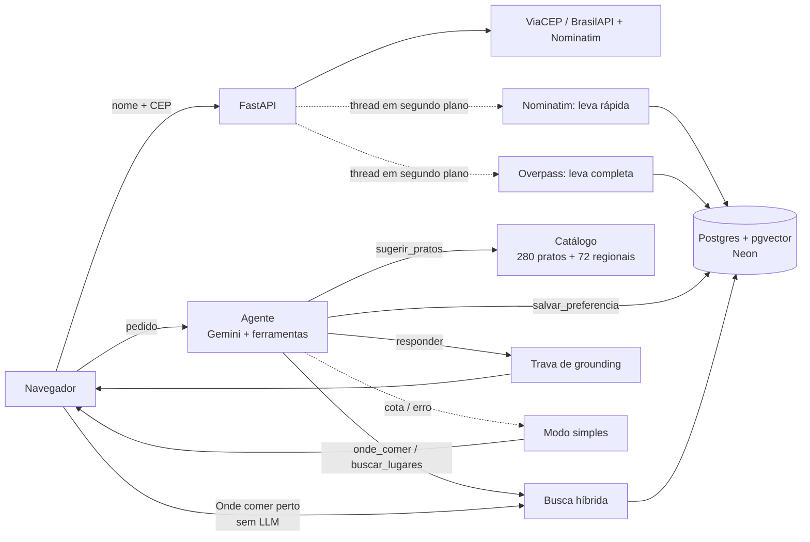

# Como o bora de quê? funciona

Guia completo do projeto: o que o site faz, passo a passo, com as tecnologias usadas em cada etapa, as decisões de engenharia e as métricas medidas.

> **Em uma frase:** a pessoa informa o nome e o CEP, conta o que está com vontade de comer, recebe **pratos** sugeridos por um agente de IA e, ao escolher um, vê **estabelecimentos reais** perto dela, com distância, horário, endereço e site.

> [!NOTE]
> Projeto de estudo, feito para aplicar na prática conhecimentos de LLMs e engenharia de IA. Não foi pensado para uso real nem para ser replicado como serviço. Veja [Sobre o projeto](../README.md#-sobre-o-projeto) no README.

---

## Sumário

1. [Visão geral](#1-visão-geral)
2. [O site, passo a passo](#2-o-site-passo-a-passo)
3. [Arquitetura](#3-arquitetura)
4. [Tecnologias](#4-tecnologias)
5. [Dados: o que é real e o que é inferido](#5-dados-o-que-é-real-e-o-que-é-inferido)
6. [O agente de IA](#6-o-agente-de-ia)
7. [A busca de lugares](#7-a-busca-de-lugares)
8. [O modelo ajustado (fine-tuning)](#8-o-modelo-ajustado-fine-tuning)
9. [Métricas e avaliações](#9-métricas-e-avaliações)
10. [Qualidade: testes, CI e pisos de regressão](#10-qualidade-testes-ci-e-pisos-de-regressão)
11. [Desempenho e custos](#11-desempenho-e-custos)
12. [Segurança, privacidade e limites](#12-segurança-privacidade-e-limites)
13. [Interface](#13-interface)
14. [Deploy](#14-deploy)
15. [Limitações conhecidas e próximos passos](#15-limitações-conhecidas-e-próximos-passos)

---

## 1. Visão geral

| | |
|---|---|
| **Problema** | "Bateu a fome, mas não sei o que comer." Decidir o prato vem antes de escolher o restaurante. |
| **Proposta** | Primeiro sugerir **o que** comer (pratos), depois mostrar **onde** comer (lugares reais por perto). |
| **Público** | Qualquer pessoa no Brasil com um CEP. |
| **Dados reais** | Estabelecimentos do OpenStreetMap, CEP pelo ViaCEP, coordenadas pelo Nominatim. |
| **IA** | Agente com chamada de ferramentas (Gemini), extrator de filtros (regras + LLM + modelo próprio ajustado com LoRA) e busca híbrida com embeddings. |
| **Codinome do pacote** | `bocado` |

Números do projeto:

| Item | Quantidade |
|---|---|
| Pratos no catálogo | 280 (17 cozinhas) |
| Pratos regionais | 72, cobrindo os 27 estados |
| Recortes reais do OSM congelados | 5 para testes/avaliação + 23 capitais para pré-carga |
| Lugares no banco de produção | ~7.500 |
| Casos de avaliação escritos/rotulados à mão | 180 (100 principais + 80 desafio) |
| Testes automatizados | 92, todos offline |

---

## 2. O site, passo a passo

### Passo 1: nome e CEP

A pessoa digita **como quer ser chamada** e o **CEP**, e entra na hora.

O que acontece por trás:

1. `POST /api/local` recebe nome e CEP.
2. O CEP vira endereço pelo **ViaCEP**, com a **BrasilAPI** de reserva se o ViaCEP falhar.
3. O endereço vira coordenadas pelo **Nominatim**, o geocodificador do OpenStreetMap. As chamadas respeitam o limite de 1 requisição por segundo da política de uso.
4. O resultado fica em cache na tabela `ceps`, então o mesmo CEP não é consultado de novo.
5. O servidor responde **imediatamente** (1 a 2 s) e dispara em segundo plano o download dos restaurantes da região (ver passo 2).
6. O navegador guarda só um identificador de visitante no `localStorage`. Na próxima visita, a pessoa entra direto.

### Passo 2: o mapa da região carrega sozinho

Enquanto a pessoa lê a tela inicial, o servidor monta o mapa de restaurantes em **duas camadas**:

| Camada | Fonte | Tempo | O que traz |
|---|---|---|---|
| Leva rápida | Nominatim, tipo a tipo (restaurante, lanchonete, padaria, café, sorveteria) | ~1 s por tipo | Até 40 lugares por tipo, com cozinha, horário e site |
| Leva completa | Overpass API (OpenStreetMap) | 35 a 60 s | Todos os lugares num raio de 2,5 km (6 km em cidades pequenas) |

As duas camadas usam o mesmo ID do OSM, então a segunda só completa a primeira, sem duplicar nada.

A região passa pelos estados `carregando` → `parcial` → `pronta`, que a interface mostra no **radar** da barra lateral. A região baixada fica salva por **30 dias**, e um CEP a até 1,5 km de uma região já baixada a reaproveita.

Se o servidor principal do Overpass não responder em 20 s, uma requisição de reserva vai para um espelho. Na primeira subida, o app carrega recortes já salvos de 23 capitais para que a demo comece com dados.

> Resultado medido: em Sorocaba, o primeiro "Onde comer perto" respondeu **3,6 s** depois do CEP. Esperando só o Overpass, eram ~60 s.

### Passo 3: a pessoa conta a vontade

Ela escreve em português livre, como "algo leve, nada de fritura", "pós-treino", "uma coisa típica daqui" ou "sou vegano, quero japonês". Também pode tocar num atalho ou num prato típico do estado.

`POST /api/chat` entrega a mensagem ao **agente** (seção 6), que:

1. chama a ferramenta `sugerir_pratos`;
2. recebe pratos do catálogo, já filtrados pelas restrições;
3. responde com uma mensagem curta e até 4 cartões de prato, cada um com o motivo da sugestão.

O agente **não** mostra restaurantes nesse momento. Pratos vêm primeiro.

### Passo 4: os cartões de prato

Cada cartão mostra:

- nome, cozinha e descrição;
- tags (vegano, sem glúten, leve, proteico, apimentado...);
- selo "típico de MG" (ou do estado) quando o prato é regional;
- o motivo, escrito pelo agente ("leve e sem fritura");
- o botão **Onde comer perto**.

Embaixo da resposta, "Como cheguei aqui" abre o **trace**: cada chamada ao LLM, cada ferramenta com argumentos e resultado, latência, tokens e custo.

### Passo 5: "Onde comer perto"

O botão chama `GET /api/onde-comer` **direto, sem LLM**. É uma busca determinística, então é instantânea e não gasta cota. Ela procura:

1. casas cujo **nome** indica o prato ("Tapiocaria" para tapioca, "Pastelaria" para pastel);
2. casas cuja **cozinha** costuma servir o prato;
3. se não houver nenhuma, **cozinhas relacionadas** (poke → japonesa), marcadas como "pode ter".

Os resultados são ordenados primeiro pela força da evidência e depois pela distância. O raio começa em 3 km e dobra até 8 km se faltar resultado.

Se o mapa ainda estiver carregando, a API responde `202` e a interface espera, mostrando cartões de carregamento.

### Passo 6: os cartões de lugar

| Campo | Origem |
|---|---|
| Nome, endereço, site | OpenStreetMap (**real**) |
| Distância | Calculada do CEP até o lugar (**real**) |
| Barra de distância | Proporcional ao raio da busca |
| Aberto agora / fechado / horário de hoje | `opening_hours` do OSM no fuso do estado (**real**). Se o formato não for entendido, aparece "horário não informado", nunca um chute |
| Dieta "✓ confirmado" | Tag de dieta do OSM (**real**) |
| Dieta "costuma ter" | Inferida pela cozinha (**inferência**) |
| "Pra pedir" | O prato escolhido e de onde vem a sugestão (**inferência**, sempre com "confira o cardápio") |
| Ver no mapa | Busca no Google Maps pelo nome e coordenadas |
| Fonte | Link para o objeto no OpenStreetMap |

### Passo 7: memória

Se a pessoa disser um **fato permanente** ("sou vegetariano", "tenho alergia a camarão"), o agente chama `salvar_preferencia`. A barra lateral mostra o que o assistente lembra, e isso vale em toda conversa futura.

Vontades do momento ("hoje nada de fritura") **não** são salvas. Um erro antigo do projeto foi justamente guardar isso.

### Passo 8: controle dos dados

- **Trocar** (no topo): muda o CEP.
- **Nova conversa**: limpa o chat.
- **Esquecer meus dados**: apaga nome, CEP, memória e conversas (`DELETE /api/visitante/{id}`).

---

## 3. Arquitetura



### Estrutura do código

```
src/bocado/
  api.py             FastAPI: endpoints, limites de uso, estáticos
  agent.py           laço do agente, trava de grounding, modo simples, "onde comer" sem LLM
  tools.py           ferramentas do agente e seus esquemas
  local/
    cep.py           CEP → endereço → coordenadas (com cache)
    osm.py           Overpass, Nominatim, cache por região, estados da área
    categorias.py    tags do OSM → cozinha do app (incluindo dedução pelo nome)
    pratos.py        pratos típicos por cozinha e regionais dos 27 estados
    cardapio.py      catálogo de pratos, regras de compatibilidade, sugestão
    busca.py         busca de lugares (RRF), "onde comer", status de dieta
    horario.py       interpretação do opening_hours e fuso por UF
  extraction/        esquema de filtros, extrator por regras, por LLM e pelo modelo ajustado
  llm/               interface comum, adaptador Gemini, LLM falso para testes
  schema.sql         tabelas: ceps, areas, lugares, visitantes, preferencias, conversas, mensagens, traces
  web/               index.html, style.css, app.js (sem framework, sem build)
evals/               casos, scripts de avaliação, resultados e pisos
finetune/            dataset, configuração do LoRA, logs de treino, cartão do modelo
data/                recortes reais e congelados do OpenStreetMap
tests/               92 testes offline
```

### Endpoints

| Método | Rota | Função |
|---|---|---|
| `POST` | `/api/local` | Nome + CEP; responde na hora e inicia o download da região |
| `GET` | `/api/visitante/{id}` | Dados do visitante, estado da região, memória, pratos regionais |
| `POST` | `/api/chat` | Turno do agente |
| `GET` | `/api/onde-comer` | Lugares para um prato (sem LLM); `202` enquanto a região carrega |
| `GET` | `/api/traces/{id}` | Trace completo de um turno |
| `DELETE` | `/api/visitante/{id}` | Apaga tudo do visitante |
| `DELETE` | `/api/visitante/{id}/memoria` | Apaga só as preferências |
| `GET` | `/api/saude` | Saúde do serviço (banco, LLM, extrator) |

---

## 4. Tecnologias

### Backend

| Tecnologia | Uso | Por quê |
|---|---|---|
| **Python 3.12** | Linguagem | Ecossistema de IA e dados |
| **FastAPI + Uvicorn** | API HTTP | Tipagem com Pydantic, validação automática, documentação OpenAPI |
| **Pydantic / pydantic-settings** | Esquemas e configuração | Valida filtros, argumentos de ferramentas e variáveis de ambiente |
| **psycopg 3 + psycopg_pool** | Acesso ao Postgres | Pool de conexões; `prepare_threshold=None` por causa do PgBouncer do Neon |
| **httpx** | Chamadas HTTP | ViaCEP, Nominatim, Overpass |

### Dados e busca

| Tecnologia | Uso | Por quê |
|---|---|---|
| **PostgreSQL 16 (Neon)** | Banco principal | Gerenciado, gratuito, escala a zero |
| **pgvector** (índice HNSW) | Busca vetorial | Similaridade semântica dentro do próprio Postgres |
| **Full-text search do Postgres** | Busca lexical | `tsvector` em português sobre uma coluna sem acentos |
| **fastembed** + `paraphrase-multilingual-MiniLM-L12-v2` | Embeddings (384 dimensões) | Multilíngue, roda em CPU, sem API paga |
| **RRF (Reciprocal Rank Fusion)** | Fusão de rankings | Combina distância, texto e vetor sem calibrar escalas diferentes |

### IA

| Tecnologia | Uso | Por quê |
|---|---|---|
| **Google Gemini** (`gemini-3.5-flash-lite`, SDK `google-genai`) | Agente com chamada de ferramentas e juiz das avaliações | Plano gratuito com 15 requisições/min; os modelos Flash têm só 20/dia |
| **Qwen2.5-0.5B-Instruct + LoRA** | Modelo próprio para extrair filtros | Experimento de fine-tuning documentado |
| **mlx-lm** | Treino do LoRA no Apple Silicon | Treina localmente, sem GPU na nuvem |
| **transformers / torch** | Inferência do modelo ajustado nas avaliações | Roda em CPU/MPS |

### Frontend

| Tecnologia | Uso |
|---|---|
| **HTML + CSS + JavaScript puro** | Sem framework e sem etapa de build: abre rápido e é fácil de auditar |
| **CSS custom properties** | Tokens da identidade visual (rosa `#FF087E`, turquesa `#3DF2D0`, lima `#D9FF43`, creme `#FFF9F3`, ameixa `#350D28`) |
| **Outfit + DM Sans** (Google Fonts) | Tipografia de títulos e de texto |
| **View Transitions API** | Transição entre entrada e app |
| **Animações CSS** | Revelação do título, órbita, radar, cartões de carregamento, inclinação 3D |

### Infraestrutura e qualidade

| Tecnologia | Uso |
|---|---|
| **Docker** | Imagem única da API + interface (porta 7860) |
| **Hugging Face Spaces** | Hospedagem gratuita do contêiner |
| **GitHub Actions** | CI (testes, avaliações offline, teste da imagem Docker), avaliações com LLM e ping diário da demo |
| **pytest + pgserver** | Testes com Postgres embutido, sem Docker e sem internet |
| **ruff** | Lint e formatação |

### Serviços externos (todos gratuitos)

| Serviço | Função | Chave? |
|---|---|---|
| ViaCEP / BrasilAPI | CEP → endereço | Não |
| Nominatim | Endereço → coordenadas; leva rápida de lugares | Não |
| Overpass API | Lugares completos do OSM | Não |
| Gemini API | LLM | Sim (plano gratuito) |
| Neon | Postgres gerenciado | Sim |

---

## 5. Dados: o que é real e o que é inferido

**Não existe fonte aberta de cardápios reais com preço.** Os apps de delivery têm esse dado, mas raspar os dados deles viola os termos de uso. Inventar cardápio para restaurantes que existem seria apresentar informação falsa sobre negócios reais. Por isso o projeto separa com cuidado:

| Real (OpenStreetMap) | Inferido (e sempre sinalizado) |
|---|---|
| Nome, endereço, coordenadas, distância | Prato sugerido: "costuma ter em hamburgueria" |
| Horário de funcionamento | Dieta "costuma ter" (pela cozinha) |
| Site e telefone | Cozinha "deduzida pelo nome" |
| Dieta confirmada (`diet:vegan=yes`) | "Pode ter" (cozinha relacionada) |
| Tipo de cozinha (quando informado) | |

Regras que evitam exagero:

- **"Costuma ter vegano"** exige que a cozinha tenha **pelo menos 2** pratos típicos veganos.
- **Casa vegetariana confirmada** só recebe sugestões vegetarianas. Isso veio de um bug real: salmão sugerido num restaurante vegetariano.
- **Dedução pelo nome** checa primeiro o que a casa vende, depois a origem e por último palavras genéricas. Assim "Pastel do Japonês" é pastelaria e "Restaurante Japonês" é japonês.
- **Sem preço, nota ou tempo de entrega**: quando o pedido cita isso, o agente recebe um aviso e explica que não tem o dado.

---

## 6. O agente de IA

### Ferramentas

| Ferramenta | O que faz |
|---|---|
| `sugerir_pratos` | Extrai filtros do pedido, soma a memória e busca no catálogo |
| `onde_comer` | Lugares reais para um prato escolhido |
| `buscar_lugares` | Busca livre de lugares ("um japonês aberto agora") |
| `salvar_preferencia` | Guarda um fato permanente (restrição, item a evitar, gosto) |
| `responder` | Encerra o turno com mensagem, pratos e lugares |

### O laço

1. O prompt de sistema traz nome, local, memória e as regras: pratos primeiro, nunca inventar preço ou nota, salvar só fatos permanentes.
2. O modelo é chamado com chamada de ferramentas no modo **obrigatório**: ele sempre chama uma ferramenta, nunca responde texto solto.
3. O código executa a ferramenta e devolve o resultado ao modelo.
4. O laço repete até `responder`, com no máximo 6 passos.

### Camadas de segurança

| Camada | Problema que resolve |
|---|---|
| **Trava de grounding** | Todo `prato_id` e `lugar_id` da resposta precisa ter vindo de uma ferramenta. Na 1ª falha, o modelo recebe o erro e corrige; na 2ª, o item é descartado. Nome, distância e links vêm do banco, nunca do texto do LLM. |
| **Restrições lidas duas vezes** | Um modelo pequeno perdeu "nada apimentado" ao reescrever o pedido. As restrições da mensagem original são extraídas por regras e aplicadas sempre. |
| **Avisos de dados ausentes** | Pedido com preço ou nota → aviso explícito para o modelo não inventar. |
| **Modo simples** | Se o LLM falha (cota, rede, limite de passos), a resposta sai do extrator de regras + catálogo, com um aviso. O site nunca mostra erro por causa do LLM. |
| **Resposta parcial** | Se o LLM cai no meio do turno, aproveita o que as ferramentas já trouxeram. |
| **Frases que dependem da conversa** | No modo simples, "gostei do primeiro" não é tratado como pedido de busca. |

### O extrator de filtros

Transforma o texto num objeto `Filtros` com estes campos: `categorias`, `restricoes`, `evitar`, `atributos`, `preco_max`, `distancia_max_km`, `tempo_max_min` e `ordenar_por`. Há três implementações intercambiáveis:

- **regras** (padrão no app): léxico + expressões regulares, instantâneo;
- **LLM**: Gemini com saída estruturada;
- **modelo ajustado**: Qwen2.5-0.5B com LoRA (seção 8).

---

## 7. A busca de lugares

1. **Candidatos**: lugares no raio (3 km, dobrando até 8 km) que passam pelos filtros de cozinha e de dieta.
2. **Três rankings**:
   - proximidade (distância);
   - lexical (full-text do Postgres sobre nome + cozinha + pratos típicos, sem acentos);
   - vetorial (cosseno dos embeddings no pgvector).
3. **Fusão por RRF** (k = 60): soma `peso / (60 + posição)` de cada ranking. Funciona sem calibrar escalas, porque cosseno e `ts_rank` não são comparáveis.
4. **Bônus pequenos** para informação confirmada (dieta no OSM, aberto agora).
5. **Sugestões de prato** por lugar, compatíveis com as restrições.

O "Onde comer perto" é uma variação mais direta: ordena por **evidência** (nome indica > cozinha costuma ter > cozinha relacionada) e depois por **distância**.

---

## 8. O modelo ajustado (fine-tuning)

| Item | Valor |
|---|---|
| Modelo base | Qwen/Qwen2.5-0.5B-Instruct |
| Técnica | LoRA (rank 16, scale 20, dropout 0,05) em todas as 24 camadas |
| Perda | Só na resposta (`mask_prompt`), não no prompt |
| Dados | 2.600 treino / 200 validação / 200 teste, gerados por templates |
| Ferramenta | mlx-lm no Apple Silicon |

A história, contada com honestidade:

| Versão | Taxa de aprendizado | Resultado |
|---|---|---|
| v1 | 2e-5, 500 iterações | Subtreinou: 35% de acerto exato ([resultado](../evals/results/v1_extracao_finetuned_pedidos.json)) |
| v2 | 1e-4 | **Divergiu** (perda de validação 3,2 na iteração 100) |
| v3 (atual) | Retoma a v1 com 3e-5, +700 iterações | **58%** nos pedidos escritos à mão, 25% no desafio |

**Conclusão:** o ajuste levou o modelo de 10% para 58%, mas ele fica abaixo das regras (90%) e do Gemini (93%). Com dados de template, o modelo aprende o formato e o vocabulário dos templates, não a variedade da escrita real. Por isso o app usa regras + Gemini, e o modelo fica como experimento documentado. O próximo passo seria destilar do Gemini com textos variados, avaliando só no conjunto escrito à mão.

---

## 9. Métricas e avaliações

Todos os números abaixo saem de execuções reais (`python evals/relatorio.py`); nada é digitado à mão.

### Conjuntos de avaliação

| Conjunto | Tamanho | Como foi feito |
|---|---|---|
| **Pedidos** | 100 | Escritos e rotulados à mão |
| **Desafio** | 80 | Textos em outros estilos (gíria, formal, "só fome") escritos pelo Gemini e **rotulados à mão** pelo [guia de rotulagem](guia-de-rotulagem.md) |
| **Lugares** | 4 capitais | Recortes reais e **congelados** do OSM (São Paulo, Belo Horizonte, Salvador, Recife), para que avaliações em datas diferentes olhem para os mesmos lugares |

### 9.1 Extração de filtros (100 pedidos)

| Extrator | Acerto exato | Média por campo | JSON válido | Latência p50 | Latência p95 | Custo / 1.000 pedidos |
|---|---|---|---|---|---|---|
| Regras (baseline) | **90,0%** | 98,8% | 100% | 0 ms | 1 ms | US$ 0 |
| Qwen2.5-0.5B sem ajuste | 10,0% | 80,9% | 1,0% | 2.941 ms | 3.778 ms | US$ 0 |
| Qwen2.5-0.5B + LoRA | 58,0% | 92,9% | 98,0% | 517 ms | 831 ms | US$ 0 |
| Gemini 3.5 flash-lite | **93,0%** | 99,1% | 100% | 971 ms | 1.490 ms | US$ 0,37 |

**Acerto por campo:**

| Campo | Regras | Qwen sem ajuste | Qwen + LoRA | Gemini |
|---|---|---|---|---|
| `categorias` | 95% | 33% | 76% | 97% |
| `preco_max` | 100% | 89% | 99% | 100% |
| `restricoes` | 100% | 80% | 94% | 99% |
| `evitar` | 99% | 91% | 94% | 100% |
| `atributos` | 98% | 79% | 91% | 98% |
| `distancia_max_km` | 98% | 95% | 99% | 100% |
| `tempo_max_min` | 100% | 93% | 99% | 100% |
| `ordenar_por` | 100% | 87% | 91% | 99% |

### 9.2 Extração no conjunto desafio (80 pedidos)

| Extrator | Acerto exato | Média por campo | Latência p50 |
|---|---|---|---|
| Regras | 66,2% | 95,2% | 1 ms |
| Qwen + LoRA | 25,0% | 85,3% | 578 ms |
| Gemini | **86,2%** | 97,3% | 944 ms |

**Leitura:** as regras vão bem no conjunto principal porque o mesmo autor escreveu o léxico e os casos. O desafio existe para expor isso, e nele as regras caem para 66%. Não ajustei as regras olhando os erros do desafio.

### 9.3 Busca em lugares reais (400 buscas: 100 pedidos × 4 capitais, top-3)

| Filtros vindos de | Categoria certa | Restrições respeitadas | Item a evitar respeitado | Prato citado aparece | Sem resultado |
|---|---|---|---|---|---|
| Gabarito | 100% | 100% | 100% | 89,6% | 4,5% |
| Regras | 95,0% | 100% | 100% | 87,0% | 4,5% |
| Modelo ajustado | 93,4% | 70,5% | 76,5% | 79,2% | 4,8% |
| Gemini | 98,5% | 100% | 100% | 92,7% | 4,5% |

O que cada métrica mede:

- **Categoria certa:** fração dos lugares cuja cozinha bate com a pedida.
- **Restrições respeitadas:** o lugar tem a restrição confirmada ou provável **e** o prato sugerido é compatível.
- **Item a evitar respeitado:** o prato sugerido não contém o que a pessoa quer evitar.
- **Prato citado aparece:** quando o pedido cita um prato ou ingrediente ("camarão", "ramen"), algum dos 3 lugares sugere um prato que casa com ele.
- **Sem resultado:** buscas que não devolveram nenhum lugar.

Com os filtros do gabarito, categoria e restrições dão 100% **por construção**: a busca filtra por eles. Essas linhas medem se a busca respeita os filtros; a qualidade da extração aparece nas linhas de regras, modelo e Gemini.

### 9.4 Agente de ponta a ponta

`evals/run_agente.py` roda conversas novas nas 4 capitais e mede:

- **grounding**: IDs fora das ferramentas antes da trava;
- **pratos primeiro**: o agente não trouxe restaurantes sem a pessoa pedir;
- **respeito ao pedido**: os pratos seguem restrições e itens a evitar;
- **preço inventado**: a mensagem citou valores que não existem;
- **nota de 1 a 5** dada por um LLM juiz.

Resultados medidos durante o desenvolvimento:

- versão anterior: 40 casos, nota média do juiz **4,7**;
- fluxo atual "pratos primeiro", execução parcial de 18 casos: **100%** com pratos primeiro e **nenhum ID inventado** na resposta final.

A execução completa do fluxo atual depende da cota diária gratuita do Gemini. O script guarda cada caso em cache e retoma de onde parou.

> Viés conhecido: o mesmo modelo atua como agente e como juiz, o que tende a inflar a nota. Por isso o juiz é complementado por métricas objetivas (grounding, restrições, preço).

---

## 10. Qualidade: testes, CI e pisos de regressão

### Testes (92, todos offline)

- **Postgres embutido** (`pgserver`) com pgvector: sem Docker e sem banco externo.
- **Recortes congelados** do OSM (São Paulo e Lavras) no lugar da internet.
- **LLM falso roteirizado**, que decide o próximo passo olhando o que recebeu e usa IDs reais.
- **Embedder por hash** nos testes, para não baixar modelo.

Cobrem: CEP e horários, classificação de cozinhas, regras de dieta, catálogo, busca, "onde comer", leva rápida (`carregando → parcial → pronta`), agente (pratos primeiro, trava de grounding, modo simples, queda no meio do turno, memória entre conversas) e API.

### CI (GitHub Actions)

| Workflow | Quando | O que faz |
|---|---|---|
| `ci.yml` | Todo push | Lint, testes, avaliações offline, checagem de pisos, build da imagem Docker e teste de fumaça (nome + CEP → chat → onde comer) |
| `evals-llm.yml` | Manual | Avaliações que gastam cota do LLM |
| `manter-acordado.yml` | Diário | Acessa a demo para ela não hibernar |

### Pisos de regressão (`evals/limites.json`)

O CI falha se alguma métrica cair abaixo do piso:

| Métrica | Piso |
|---|---|
| Extração por regras: acerto exato | 88% |
| Extração por regras: média por campo | 98% |
| Extração por regras no desafio: acerto exato | 64% |
| Busca (gabarito): categoria, restrições e evitar | 100% |
| Busca (gabarito): prato citado aparece | 88% |
| Busca (regras): restrições respeitadas | 95% |
| Modelo ajustado: JSON válido | 95% |

---

## 11. Desempenho e custos

| Operação | Tempo típico |
|---|---|
| Nome + CEP até entrar no app | 1 a 2 s |
| Primeira leva de lugares (Nominatim) | ~1 s por tipo |
| Região completa (Overpass) | 35 a 60 s, em segundo plano |
| Turno do agente (Gemini flash-lite) | ~1 s por chamada; 2 a 4 chamadas por turno |
| "Onde comer perto" (sem LLM) | Instantâneo com a região pronta |
| Extração por regras | < 1 ms |

**Custo:** o app roda no plano gratuito do Gemini. O custo exibido no trace usa o preço de tabela do flash-lite (US$ 0,30 por 1M tokens de entrada e US$ 2,50 por 1M de saída). Extrair filtros de 1.000 pedidos via Gemini custaria cerca de **US$ 0,37**. Banco (Neon), hospedagem (Hugging Face Spaces) e fontes de dados são gratuitos.

---

## 12. Segurança, privacidade e limites

- **Sem conta e sem senha.** Só um identificador aleatório no navegador.
- **Dados guardados:** nome, CEP, preferências permanentes e conversas. Tudo apagável com um botão.
- **Limites de uso por IP:** 20 turnos de chat e 10 consultas de CEP a cada 10 minutos.
- **Teto diário de turnos com LLM** (300 por dia); acima disso, o app usa o modo simples.
- **Segredos** (`GEMINI_API_KEY`, `DATABASE_URL`) só em variáveis de ambiente, nunca no repositório.
- **Respeito às fontes:** 1 requisição/s ao Nominatim, User-Agent com nome, versão e link do repositório, requisição de reserva ao Overpass só depois de 20 s, atribuição ODbL na interface.
- **Erros internos** viram uma mensagem genérica para o usuário e um log detalhado no servidor.

---

## 13. Interface

Conceito visual: **"a lupa procurando o seu prato"**.

| Momento | Detalhe |
|---|---|
| Entrada | Título revelado palavra a palavra com um traço desenhado sob "Achou o prato."; órbita de pratos em volta da lupa; etiquetas flutuantes ("aberto agora · 450 m"); faixa com pratos regionais |
| Formulário | Cartão de vidro com rótulos flutuantes e máscara de CEP |
| Barra lateral | Radar que varre enquanto a região carrega, pontos que surgem conforme os lugares chegam (até 48) e contador animado |
| Início do chat | Herói com atalhos (incluindo pratos típicos do estado) e "como funciona" em 3 passos |
| Enquanto pensa | Cartões de carregamento com brilho no lugar dos três pontinhos |
| Cartões | Entram em sequência e inclinam em 3D seguindo o ponteiro, com brilho |
| Campo de mensagem | Exemplos que se digitam sozinhos ("algo leve pro almoço…") |
| Acessibilidade | `prefers-reduced-motion` desliga as animações; `aria-live` nas mensagens; foco sem rolagem indesejada |
| Responsivo | Layout próprio abaixo de 860 px, sem rolagem horizontal |

---

## 14. Deploy

**Demo ao vivo:** [bora-de-que.onrender.com](https://bora-de-que.onrender.com). Ela roda no plano gratuito do Render (512 MB) com uma versão enxuta: os pesos int8 oficiais do mesmo modelo de embeddings e o tokenizer SentencePiece, que levam o pico de memória de ~810 MB para ~470 MB. Na busca, só "prato citado aparece" muda (de 89,6% para 89,1%). O README detalha a comparação.

Para publicar o projeto completo (Hugging Face Space do tipo Docker, que hoje exige o plano PRO):

1. **Banco:** projeto no Neon (Postgres com pgvector).
2. **App:** Hugging Face Space do tipo Docker (`python scripts/publicar_space.py --space USUARIO/bora-de-que`).
3. **Segredos** no Space: `DATABASE_URL` e `GEMINI_API_KEY`; variável `REPO_URL` com o link do repositório.
4. Na primeira subida, o app cria as tabelas e carrega os recortes das capitais sozinho.
5. Variável `DEMO_URL` no GitHub para o ping diário.

Para rodar localmente:

```bash
python3.12 -m venv .venv && source .venv/bin/activate
pip install -e ".[dev]"
bash scripts/dev.sh        # Postgres embutido + servidor em http://127.0.0.1:8000
```

Comandos úteis da CLI `bocado`:

| Comando | Função |
|---|---|
| `bocado init-db [--reset]` | Aplica o esquema |
| `bocado aquecer` | Carrega os recortes salvos do OSM |
| `bocado reclassificar` | Refaz as categorias a partir das tags guardadas |
| `bocado local CEP` | Resolve um CEP e baixa a região |
| `bocado buscar "texto" --cep CEP` | Testa extração + busca |
| `bocado chat --cep CEP --trace` | Conversa no terminal mostrando cada passo |
| `bocado serve` | Sobe a API e a interface |

---

## 15. Limitações conhecidas e próximos passos

**Limitações**

- Sem cardápio real: o prato sugerido é típico do tipo de cozinha, não do cardápio da casa.
- Sem preço, nota ou tempo de entrega.
- A cobertura do OpenStreetMap varia: cerca de metade dos lugares não informa a cozinha.
- A cota gratuita do Gemini limita a demo; acima dela, entra o modo simples.
- O modelo ajustado generaliza mal fora dos templates.

**Próximos passos**

- Com cardápio real (por exemplo, integrado a uma plataforma de delivery): trocar "típico" por prato real com preço e disponibilidade, ativar filtros de preço e tempo, e fazer a trava de grounding checar IDs de prato do cardápio.
- Destilar o extrator do Gemini com textos variados.
- Medir impacto com métricas de produto: conversão de sugestão em pedido, tempo até decidir e taxa de "nada encontrado".
- Juiz de outro fornecedor para reduzir o viés da autoavaliação.
